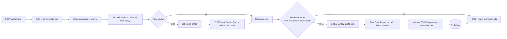
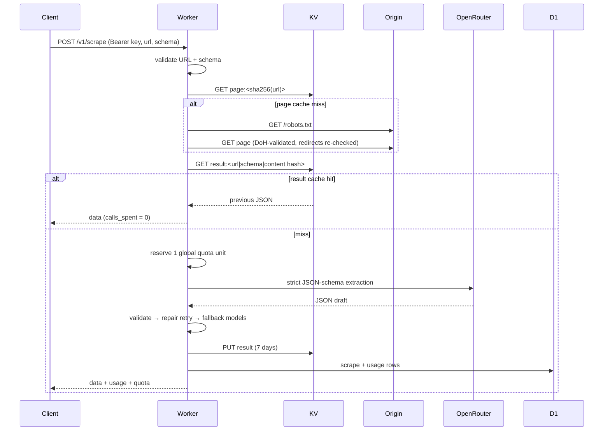

# llm-scraper — SSRF-safe, schema-validated web extraction

`POST /v1/scrape`: give it a public URL and a target schema (or a built-in one). It validates the URL, checks `robots.txt`, fetches the page safely, strips navigation/footer/script boilerplate, extracts the main text, then asks a free OpenRouter model for JSON that matches your schema. Results are validated before being returned and cached by URL + schema + content hash.

> Portfolio project #8. Unlike a generic extraction API, this one owns the **fetching** half: SSRF protection, redirect re-validation, robots compliance and HTML-to-text cleanup. It also uses a dependency-free JSON-Schema validator that works in the Workers runtime.

## Live

- API: `https://llm-scraper.bhalder.workers.dev`
- Browser demo: `https://llm-scraper.bhalder.workers.dev/demo`
- Health: `https://llm-scraper.bhalder.workers.dev/health`

## Architecture





## What makes it interesting

| Concern | Implementation |
|---|---|
| SSRF | Blocks local/private/reserved IPv4 and IPv6, credentials in URL, non-http schemes; resolves hostnames through DNS-over-HTTPS and rejects private answers; re-checks every redirect hop. Optional `ALLOWED_HOSTS` / `BLOCKED_HOSTS`. |
| robots.txt | Fetches and parses `robots.txt`, honors the longest matching Allow/Disallow rule for `*` or this agent; fails open only when robots.txt is unreachable. |
| Content cleanup | Removes script/style/nav/header/footer/ads/cookie banners, prefers `<article>`/`<main>`, decodes entities, normalizes whitespace and caps text size. Non-HTML text and JSON are supported too. |
| Validation | Caller JSON Schema is sanitized into the strict subset OpenRouter accepts; model output is checked with a small recursive validator (no `ajv` — Workers disallow `eval`), with one repair retry and model fallback. |
| Quota | Page cache (1 h) + result cache (7 d) + atomic 50/day D1 ledger. Only unique page+schema pairs spend model calls. When quota is gone the API still returns a null-only JSON skeleton. |
| Observability | `GET /v1/usage` shows scrapes, cache hits, tokens and global quota; D1 stores every scrape and call. |

## API

| Method | Path | Auth | Description |
|---|---|---|---|
| `POST` | `/v1/scrape` | Bearer | Scrape a URL into structured JSON |
| `GET` | `/v1/scrape` | Bearer | Recent scrapes |
| `GET` | `/v1/scrape/:id` | Bearer | One stored scrape |
| `GET` | `/v1/schemas` | Bearer | Built-in schema catalog |
| `GET` | `/v1/usage` | Bearer | Aggregates + global quota |
| `GET` | `/v1/usage/events` | Bearer | Recent calls |
| `GET` | `/health` | public | Status + quota |
| `GET` | `/demo` | public | Browser demo |
| `POST` | `/admin/keys` | `x-admin-token` | Mint a key |
| `GET` | `/admin/keys` | `x-admin-token` | List keys |
| `POST` | `/admin/keys/:id/revoke` | `x-admin-token` | Revoke a key |

See [`openapi.yaml`](./openapi.yaml) for the full contract.

```bash
# Mint a key
curl -X POST https://llm-scraper.bhalder.workers.dev/admin/keys \
  -H 'x-admin-token: <ADMIN_TOKEN>' -H 'content-type: application/json' \
  -d '{"label":"demo"}'

# Built-in schema
curl -X POST https://llm-scraper.bhalder.workers.dev/v1/scrape \
  -H 'Authorization: Bearer scr_...' -H 'content-type: application/json' \
  -d '{"url":"https://example.com/article","schema_id":"article"}'

# Your own schema
curl -X POST https://llm-scraper.bhalder.workers.dev/v1/scrape \
  -H 'Authorization: Bearer scr_...' -H 'content-type: application/json' \
  -d '{
    "url": "https://example.com/product",
    "schema": {
      "name": "product_mini",
      "json_schema": {
        "type": "object",
        "properties": {
          "name": { "type": ["string", "null"] },
          "price": { "type": ["string", "null"] },
          "features": { "type": "array", "items": { "type": "string" } }
        }
      }
    }
  }'
```

Example response:

```json
{
  "data": {
    "title": "Example Article",
    "author": null,
    "published_at": "Tuesday",
    "summary": "The council approved twelve electric buses and two extended routes.",
    "topics": ["transport", "city"],
    "tone": "neutral"
  },
  "source": {
    "url": "https://example.com/article",
    "final_url": "https://example.com/article",
    "title": "Example Article",
    "text_chars": 512,
    "truncated": false,
    "content_hash": "6f1a..."
  },
  "schema": { "name": "article", "hash": "9bc2..." },
  "strategy": "model",
  "model": "inclusionai/ling-3.2-flash:free",
  "cached": false,
  "calls_spent": 1,
  "quota": { "remaining": 49, "limit": 50 }
}
```

## How I stayed within 50 requests/day

1. Pages are cached for 1 hour by URL — repeat scrapes do not refetch or re-check robots.
2. Results are cached for 7 days by `(URL, schema hash, content hash, prompt version)` — unchanged pages never spend a model call.
3. A D1 ledger reserves each model attempt atomically, including repair retries and fallback models.
4. If the budget is exhausted, the API returns a schema-shaped JSON skeleton with `strategy: "fallback"` instead of erroring.
5. Tests stub `fetch` completely, so CI spends zero quota.

## Local development

```bash
npm install
cp .dev.vars.example .dev.vars    # OPENROUTER_API_KEY + ADMIN_TOKEN
# The D1 free tier is at its 10-database limit, so this project shares
# cmg-db with commit-message-cli using scraper_-prefixed tables.
npx wrangler kv namespace create SCRAPER_CACHE
# paste the KV ID into wrangler.toml, re-check the free model list at
# https://openrouter.ai/models?max_price=0
npm run db:migrate:local
npm run db:migrate:remote
wrangler secret put OPENROUTER_API_KEY
wrangler secret put ADMIN_TOKEN
npm run dev

npm run typecheck
npm test
npx wrangler deploy --dry-run
npm run deploy
```

## Tests

`npm test` runs unit tests (SSRF guards, robots parsing, HTML cleanup, JSON Schema strictness/validation) and integration tests with an in-memory D1/KV double and a URL-routed `fetch` stub. No test touches the network or OpenRouter.

## Deployed resources

- Worker: `llm-scraper` on `bhalder.workers.dev`
- D1: shared `cmg-db` — `scraper_api_keys`, `scraper_rate_counters`, `scraper_quota_daily`, `scraper_scrapes`, `scraper_usage`
- KV: `CACHE` — page cache, result cache, free-model roster
- GitHub: `biswajit-halder/llm-scraper`

## Known limitations

- Regex-based HTML cleanup is deliberately lightweight; heavily JS-rendered pages need Browser Rendering.
- Plain-text content types are supported; PDFs are not (that lives in `async-ai-job-queue`).
- A caller-supplied schema is restricted to objects/arrays/scalars with basic constraints — no `$ref`, `oneOf` or recursive schemas.

## Interview notes

- **Why not `ajv`?** Its JIT compiler uses `new Function`, which Workers disallow. A small validator for the supported subset is safer and auditable.
- **Why re-check redirects?** A hostname that passes validation can redirect to `127.0.0.1`; every hop is revalidated before fetching.
- **Why cache by content hash?** A URL can change. Keying on the extracted text means stale results are never served, while unchanged pages still cost nothing.
- **Why a fallback skeleton?** Scraping tools should be composable; returning a schema-shaped object keeps downstream code simple even when the free tier is exhausted.
